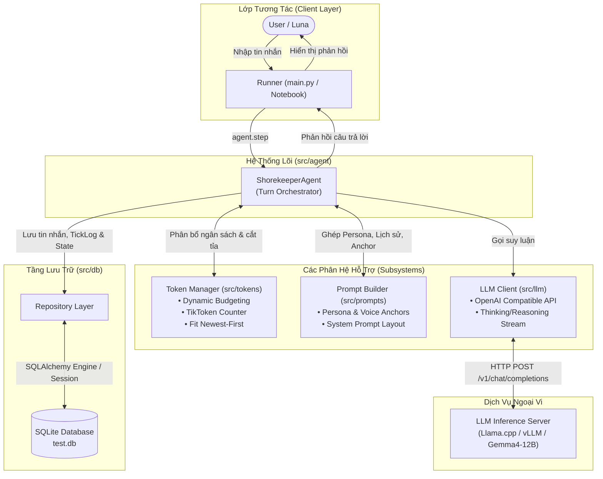
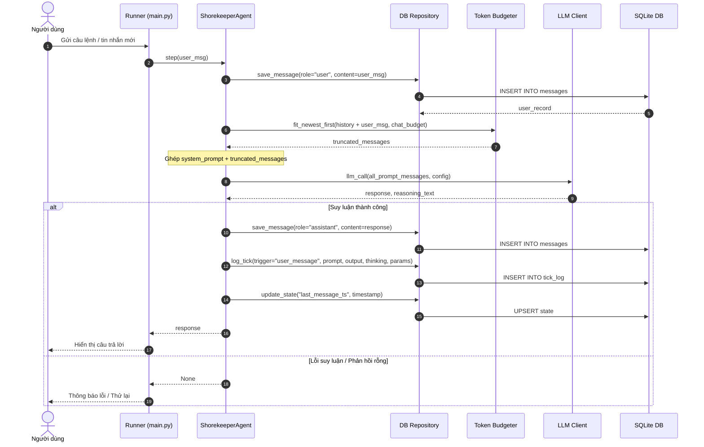
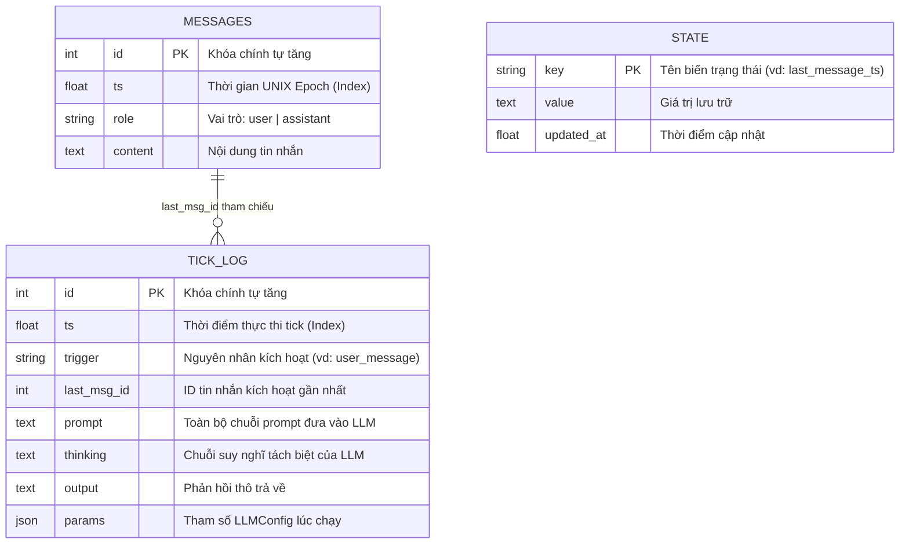

# Kiến Trúc Hệ Thống Shorekeeper Agent

> **Tài liệu sống (Living Document):** Tài liệu này phản ánh trung thực trạng thái kiến trúc hiện tại của dự án Shorekeeper Agent. Mọi thay đổi kiến trúc, luồng xử lý hoặc cấu trúc dữ liệu **bắt buộc phải được cập nhật đồng thời trong cùng Pull Request (PR)**.

| Thông Tin | Chi Tiết |
| :--- | :--- |
| **Dự án** | Shorekeeper Agent |
| **Phiên bản tài liệu** | 1.0.0 |
| **Ngày cập nhật gần nhất** | 2026-10-30 |
| **Trạng thái** | Active / Maintained |
| **Chính sách PR** | **Docs-as-Code** — Bắt buộc review & update khi sửa đổi core / db / llm / tokens |

---

## 1. Tổng Quan Hệ Thống (System Overview)

**Shorekeeper Agent** là một hệ thống AI Agent độc lập, hướng tới khả năng trò chuyện bền bỉ, nhận thức ngữ cảnh thời gian thực và quản lý tài nguyên token nghiêm ngặt. Hệ thống được thiết kế theo các nguyên tắc cốt lõi:

*   **Ngân sách Token Tất định (Strict Token Budgeting):** Sử dụng chiến lược dynamic budgeting và xếp lịch *newest-first* để cửa sổ ngữ cảnh không bao giờ vượt ngưỡng giới hạn của LLM backend.
*   **Ký Ức Bền Vững (Persistent Storage):** Lưu trữ toàn bộ lịch sử tin nhắn, trạng thái runtime và nhật ký suy luận (Tick Log) vào SQLite thông qua SQLAlchemy ORM.
*   **Quan Sát Toàn Diện (Full Observability):** Ghi nhận đầy đủ Prompt nguyên bản, chuỗi suy nghĩ (Thinking / Reasoning trace) và phản hồi của LLM sau mỗi lượt hội thoại.
*   **Kiến Trúc Mô-đun (Decoupled Modularity):** Phân tách rành mạch giữa lớp lưu trữ dữ liệu, tính toán token, tạo prompt và giao tiếp LLM.

---

## 2. Sơ Đồ Kiến Trúc Tổng Thể (High-Level Architecture)

Biểu đồ dưới đây mô tả luồng giao tiếp giữa người dùng, tầng điều phối (Orchestrator), các hệ thống con và cơ sở dữ liệu:



---

## 3. Cấu Trúc Các Thành Phần (Component Architecture)

```
src/
├── agent/       # Bộ điều phối vòng đời (Lifecycle & Turn Orchestrator)
├── config/      # Cấu hình môi trường & hằng số hệ thống (Pydantic Settings)
├── db/          # Tầng lưu trữ: ORM Models, Repository CRUD, SessionLocal
├── llm/         # HTTP Client gọi Backend suy luận & Schema tham số
├── prompts/     # Xây dựng System Prompt, Persona Core và Voice Anchors
└── tokens/      # Định lượng token và giải thuật tối ưu hóa Context Window
```

### 3.1. Agent Orchestrator (`src/agent/agent.py`)
Đóng vai trò là trung tâm chỉ huy:
1.  Khởi tạo ngân sách token (`dynamic_budget`).
2.  Xây dựng System Prompt ban đầu theo định mức token cho phép.
3.  Tải lịch sử hội thoại gần nhất và cắt tỉa theo thuật toán `fit_newest_first`.
4.  Thực hiện phương thức `step(user_msg)` để vận hành chu kỳ một lượt nói chuyện.

### 3.2. Token & Budget Management (`src/tokens/`)
*   **`budget.py`**: Chia nhỏ tổng `CONTEXT_WINDOW` (mặc định 4096 hoặc 8192) thành các ngăn:
    *   `persona`: Định nghĩa nhân cách lõi.
    *   `anchor`: Mỏ neo giọng điệu (đặt ở cuối prompt để giữ vững tính cách).
    *   `chat`: Dành cho lịch sử hội thoại gần nhất (cắt tỉa theo cơ chế newest-first).
    *   `reply`: Ngân sách bảo lưu cho câu trả lời của mô hình.
*   **`counter.py`**: Sử dụng thư viện `tiktoken` (bộ mã hóa `cl100k_base`) để đếm token chuẩn xác, kèm thuật toán heuristic dự phòng khi offline.

### 3.3. Prompt Engineering (`src/prompts/`)
*   **`templates.py`**: Định hình bản sắc của Shorekeeper (người bảo vệ Black Shores, phong thái điềm tĩnh, dịu dàng, thông tuệ).
*   **`builder.py`**: Lắp ráp prompt theo trật tự logic:
    $$\text{Prompt} = [\text{System Persona}] + [\text{Recent Chat History}] + [\text{Voice Anchor}]$$

### 3.4. LLM Client (`src/llm/`)
*   Giao tiếp với các endpoint tương thích OpenAI (`/v1/chat/completions`).
*   Hỗ trợ cấu hình mô hình, nhiệt độ (temperature), chuỗi suy nghĩ (`enable_thinking`, `reasoning_effort`).
*   Bóc tách riêng chuỗi suy nghĩ (`reasoning`) và nội dung trả lời (`output`).

### 3.5. Persistence Layer (`src/db/`)
*   Quản lý phiên làm việc SQLite thông qua SQLAlchemy 2.0.
*   Thực thi lưu vết tự động: tin nhắn người dùng, tin nhắn phản hồi, trạng thái thời gian thực (`StateField`) và nhật ký mỗi tick (`TickLog`).

---

## 4. Chu Trình Thực Thi Một Lượt Hội Thoại (Turn Execution Lifecycle)

Biểu đồ tuần tự dưới đây mô tả chính xác những gì diễn ra trong hàm `agent.step(user_msg)`:



---

## 5. Sơ Đồ Cơ Sở Dữ Liệu (Entity Relationship Diagram)

Hệ thống sử dụng mô hình cơ sở dữ liệu nhẹ, tối ưu cho tốc độ đọc/ghi cục bộ:



---

## 6. Quy Định Đồng Bộ Kiến Trúc Với Pull Request (PR Governance)

Để kiến trúc hệ thống không bị lỗi thời theo thời gian, mọi kỹ sư và cộng tác viên **phải tuân thủ quy tắc đồng bộ bắt buộc**:

> [!IMPORTANT]
> ### Nguyên Tắc "Docs as Code"
> Bất kỳ Pull Request (PR) nào làm thay đổi một trong các khía cạnh dưới đây **bắt buộc phải cập nhật file `docs/architecture.md` trong cùng PR đó**:
> 1. **Thay đổi mô hình dữ liệu (`src/db/models.py`)**: Bổ sung bảng mới, trường mới hoặc thay đổi quan hệ trong ERD.
> 2. **Thay đổi luồng hội thoại (`src/agent/agent.py`)**: Sửa đổi quy trình các bước trong hàm `step()` hoặc thêm lifecycle hooks.
> 3. **Thay đổi cấu trúc phân bổ Token (`src/tokens/`)**: Đổi thuật toán ngân sách hoặc chia lại tỷ trọng persona/chat/reply.
> 4. **Thay đổi giao thức LLM (`src/llm/`)**: Thêm provider mới, cấu trúc lại streaming hoặc cơ chế reasoning.

### Checklist Kiểm Duyệt Pull Request (PR Reviewer Checklist)
Khi review một PR, reviewer cần tích chọn:
* [ ] Mã nguồn đã được kiểm thử với `pytest` đạt 100% pass.
* [ ] Kiến trúc có thay đổi không? Nếu có:
  * [ ] Đã cập nhật mục tương ứng trong `docs/architecture.md`.
  * [ ] Đã cập nhật Mermaid diagram tương ứng nếu luồng thay đổi.
  * [ ] Đã cập nhật trường **Ngày cập nhật gần nhất** ở đầu file này thành ngày hiện tại (`YYYY-MM-DD`).
