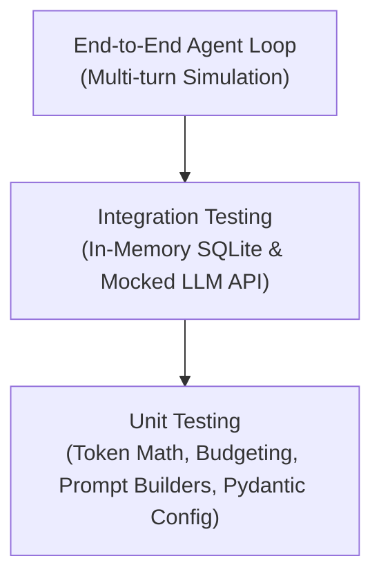
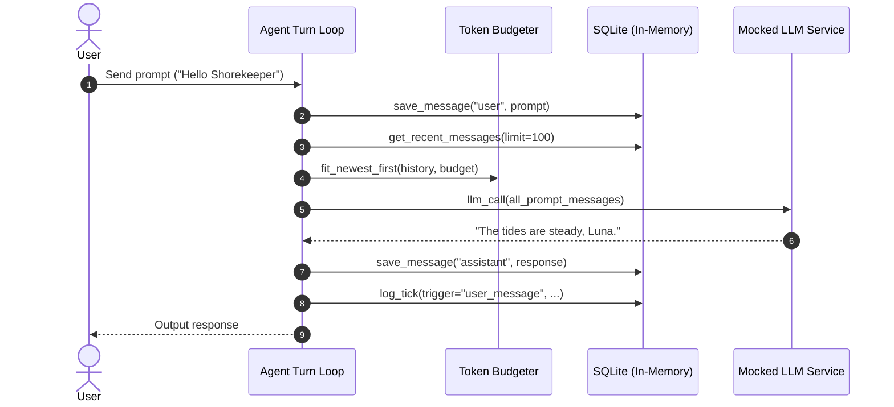

# Shorekeeper Core — Comprehensive Test Architecture & Roadmap

> *"To safeguard the quiet tides of memory, every ripple of logic must be attuned with unwavering precision."*

This document outlines the testing architecture for the **Shorekeeper** AI Agent codebase. It establishes a multi-tiered test suite ensuring data persistence integrity, token budget constraints, prompt determinism, and inference resilience.

---

## 1. Architectural Pre-requisite: Codebase Decoupling

Currently, the agent logic resides within [main.ipynb](file:///Users/dinhtronganh/Documents/ProjectShoreKeeper/NoVibeCode/Agent/main.ipynb). Automated test frameworks like `pytest` require importable Python modules.

### Proposed Directory Layout

```text
Agent/
├── src/
│   ├── __init__.py            # Unified package exports
│   ├── agent/                 # Agent turn lifecycle
│   │   └── agent.py
│   ├── config/                # Settings & limits
│   │   └── settings.py
│   ├── db/                    # SQLAlchemy models & sessions
│   │   ├── models.py
│   │   ├── session.py
│   │   └── repository.py
│   ├── llm/                   # Client & LLMConfig
│   │   ├── client.py
│   │   └── config.py
│   ├── prompts/               # Persona & template builders
│   │   ├── templates.py
│   │   └── builder.py
│   └── tokens/                # Token math & budgeting
│       ├── counter.py
│       └── budget.py
├── tests/
│   ├── conftest.py            # Pytest fixtures (in-memory SQLite, mock clients)
│   ├── unit/
│   │   ├── test_tokens.py     # Token counting & window fitting
│   │   ├── test_config.py     # LLMConfig validation & payload formatting
│   │   └── test_prompts.py    # Prompt template assembly
│   ├── integration/
│   │   ├── test_db.py         # In-memory database CRUD & ordering
│   │   └── test_llm.py        # Mocked API client & error boundaries
│   └── e2e/
│       └── test_agent_turn.py # End-to-end multi-turn chat simulation
├── pytest.ini
├── main.py
├── main.ipynb
└── test.db
```

---

## 2. Testing Pyramid & Target Layers



---

## 3. Detailed Test Specifications

### Layer 1: Unit Testing (Pure Logic & Invariants)

#### A. Token Counting & Window Management ([tokens.py])
*   **`count_tokens`**:
    *   `test_count_tokens_empty`: Empty string or `None` returns `0`.
    *   `test_count_tokens_tiktoken`: Accurate token count when `tiktoken` is active.
    *   `test_count_tokens_fallback`: Accurate token approximation (~3.8 char heuristic) when `_ENCODER is None`.
*   **`count_message_tokens`**:
    *   `test_count_message_tokens_framing`: Verifies role + content tokens + 4 framing overhead delimiter tokens.
*   **`dynamic_budget`**:
    *   `test_dynamic_budget_valid`: Context window (e.g., 8000) splits cleanly between persona, chat, anchor, and reply.
    *   `test_dynamic_budget_exhausted`: When total budget $\le$ fixed allocations, returns `None`.
*   **`fit_newest_first`**:
    *   `test_fit_all_messages`: All messages fit when total tokens $\le$ budget.
    *   `test_fit_prunes_oldest_first`: Prunes oldest turns when budget is constrained, retaining strictly newest messages.
    *   `test_fit_preserves_chronological_order`: Output order remains oldest $\rightarrow$ newest.
    *   `test_fit_single_message_exceeds_budget`: Returns empty list when even the single newest message exceeds budget.

#### B. Configuration & Validation ([config.py])
*   **`LLMConfig`**:
    *   `test_llm_config_defaults`: Ensures default hyperparameters match expectations (`model="default"`, `temperature=0.8`).
    *   `test_to_payload_params`: Verifies nested payload structure (`chat_template_kwargs`, `thinking`, `reasoning_effort`).
    *   `test_pydantic_type_validation`: Rejects invalid parameter types.

#### C. Prompt Construction ([prompts.py])
*   **`build_system_prompt`**:
    *   `test_build_system_prompt_within_budget`: Returns system turn when token count $<$ budget.
    *   `test_build_system_prompt_overflow`: Returns `None` when budget is too tight.
*   **`build_message`**:
    *   `test_build_message_formatting`: Verifies context time tail `[Context: Current time: HH:MM]` is cleanly prepended.

---

### Layer 2: Database Integration Testing (SQLite In-Memory)

Tests run against an in-memory database (`sqlite:///:memory:`) using isolated sessions per test function to guarantee zero side-effects.

*   **`save_message`**:
    *   `test_save_message_success`: Inserts `user` and `assistant` rows, auto-generates sequential IDs and timestamps.
    *   `test_save_message_rollback_on_failure`: Handles exceptions gracefully without corrupting session state.
*   **`get_recent_messages`**:
    *   `test_get_recent_messages_order`: Inserts 10 messages with varying timestamps; querying with `limit=5` returns the **latest 5**, ordered chronologically from **oldest to newest**.
    *   `test_get_recent_messages_empty_table`: Returns empty list / handles empty state gracefully.
*   **`log_tick`**:
    *   `test_log_tick_serialization`: Ensures tick row is committed with `trigger`, `last_msg_id`, and JSON-serialized `params`.

---

### Layer 3: External Inference Mocking & Resilience ([llm.py])

The agent must handle upstream LLM outages gracefully without crashing the chat session.

*   `test_llm_call_success`: Mocks HTTP 200 with standard OpenAI-compatible response; verifies extraction of `choices[0].message.content`.
*   `test_llm_call_http_error`: Mocks HTTP 429 (Rate Limit) and HTTP 500 (Internal Server Error); asserts function returns `None` and does not raise uncaught exceptions.
*   `test_llm_call_timeout`: Mocks network timeout; verifies graceful handling.

---

### Layer 4: End-to-End Agent Turn Simulation

Simulates complete user interaction cycles using in-memory database and mocked LLM inference.



---

## 4. Test Fixtures Architecture (`conftest.py`)

```python
import pytest
from sqlalchemy import create_engine
from sqlalchemy.orm import sessionmaker
from src.db.models import Base

@pytest.fixture
def in_memory_db():
    engine = create_engine("sqlite:///:memory:")
    Base.metadata.create_all(bind=engine)
    TestingSessionLocal = sessionmaker(autocommit=False, autoflush=False, bind=engine)
    session = TestingSessionLocal()
    try:
        yield session
    finally:
        session.close()
        Base.metadata.drop_all(bind=engine)

@pytest.fixture
def mock_llm_response(monkeypatch):
    def _mock(content: str):
        class MockResponse:
            status_code = 200
            def json(self):
                return {"choices": [{"message": {"content": content}}]}
            def raise_for_status(self):
                pass
        monkeypatch.setattr("requests.post", lambda *args, **kwargs: MockResponse())
    return _mock
```

---

## 5. Reference Implementation: Unit Test Example (`tests/unit/test_tokens.py`)

Below is the concrete implementation of `tests/unit/test_tokens.py`, verifying token calculation invariants and window trimming logic using `pytest`:

```python
import pytest

from src.tokens.budget import dynamic_budget, fit_newest_first
from src.tokens.counter import count_message_tokens, count_tokens


class TestCountTokens:
    def test_count_tokens_empty(self):
        """Verifies that None or empty strings yield 0 tokens."""
        assert count_tokens("") == 0
        assert count_tokens(None) == 0

    def test_count_tokens_tiktoken(self):
        """Verifies accurate token calculation via tiktoken."""
        # 'Hello, world!' in cl100k_base encodes to 4 tokens
        text = "Hello, world!"
        assert count_tokens(text) == 4

    def test_count_tokens_fallback(self, monkeypatch):
        """Verifies the heuristic fallback (~3.8 chars/token) when tiktoken is unavailable."""
        import src.tokens.counter as counter_mod

        monkeypatch.setattr(counter_mod, "_ENCODER", None)
        text = "This is a simple text sentence for testing fallback."
        expected = max(1, int(len(text) / 3.8))
        assert count_tokens(text) == expected


class TestCountMessageTokens:
    def test_count_message_tokens_framing(self):
        """Verifies framing overhead (4 tokens) is added to role and content tokens."""
        message = {"role": "user", "content": "Hello"}
        expected = 4 + count_tokens("user") + count_tokens("Hello")
        assert count_message_tokens(message) == expected


class TestDynamicBudget:
    def test_dynamic_budget_valid(self):
        """Verifies context window splits cleanly into allocated segments."""
        budget = dynamic_budget(budget=8000, persona=600, anchor=200, reply=2000)
        assert budget is not None
        assert budget["persona"] == 600
        assert budget["anchor"] == 200
        assert budget["reply"] == 2000
        assert budget["chat"] == 8000 - 600 - 200 - 2000  # 5200

    def test_dynamic_budget_exhausted(self):
        """Returns None when budget cannot fulfill fixed overheads."""
        # Total fixed overhead: 600 + 200 + 2000 = 2800
        assert dynamic_budget(budget=2800, persona=600, anchor=200, reply=2000) is None
        assert dynamic_budget(budget=1000, persona=600, anchor=200, reply=2000) is None


class TestFitNewestFirst:
    def test_fit_all_messages(self):
        """Verifies all messages are retained if they fit within budget."""
        messages = [
            {"role": "user", "content": "Hi"},
            {"role": "assistant", "content": "Greetings"},
        ]
        total_tokens = sum(count_message_tokens(m) for m in messages)
        result = fit_newest_first(messages, budget=total_tokens + 10)
        assert result == messages

    def test_fit_prunes_oldest_first(self):
        """Verifies that older messages are discarded while newer ones are preserved."""
        msg1 = {"role": "user", "content": "First message from long ago"}
        msg2 = {"role": "assistant", "content": "Second response"}
        msg3 = {"role": "user", "content": "Third newest query"}

        messages = [msg1, msg2, msg3]
        cost3 = count_message_tokens(msg3)
        cost2 = count_message_tokens(msg2)

        # Budget allows msg2 and msg3, but not msg1
        budget = cost2 + cost3
        result = fit_newest_first(messages, budget=budget)

        assert len(result) == 2
        assert result == [msg2, msg3]

    def test_fit_preserves_chronological_order(self):
        """Verifies the final list is strictly ordered oldest -> newest."""
        messages = [
            {"role": "user", "content": "Turn 1"},
            {"role": "assistant", "content": "Turn 2"},
            {"role": "user", "content": "Turn 3"},
        ]
        result = fit_newest_first(messages, budget=500)
        assert [m["content"] for m in result] == ["Turn 1", "Turn 2", "Turn 3"]

    def test_fit_single_message_exceeds_budget(self):
        """Returns an empty list if even the single newest message exceeds budget."""
        messages = [{"role": "user", "content": "A long message exceeding budget"}]
        cost = count_message_tokens(messages[0])
        result = fit_newest_first(messages, budget=cost - 1)
        assert result == []
```

---

## 6. Implementation Roadmap

1.  **Refactor**: Extract code from [main.ipynb](file:///Users/dinhtronganh/Documents/ProjectShoreKeeper/NoVibeCode/Agent/main.ipynb) into structured modules under `src/`.
2.  **Environment**: Install `pytest` and `pytest-mock` inside the `.venv`.
3.  **Fixtures**: Establish `tests/conftest.py` with in-memory database lifecycle.
4.  **Unit Tests**: Implement tests for token math, budgeting, and models.
5.  **Integration & E2E**: Implement database ordering tests and mocked conversational turns.
